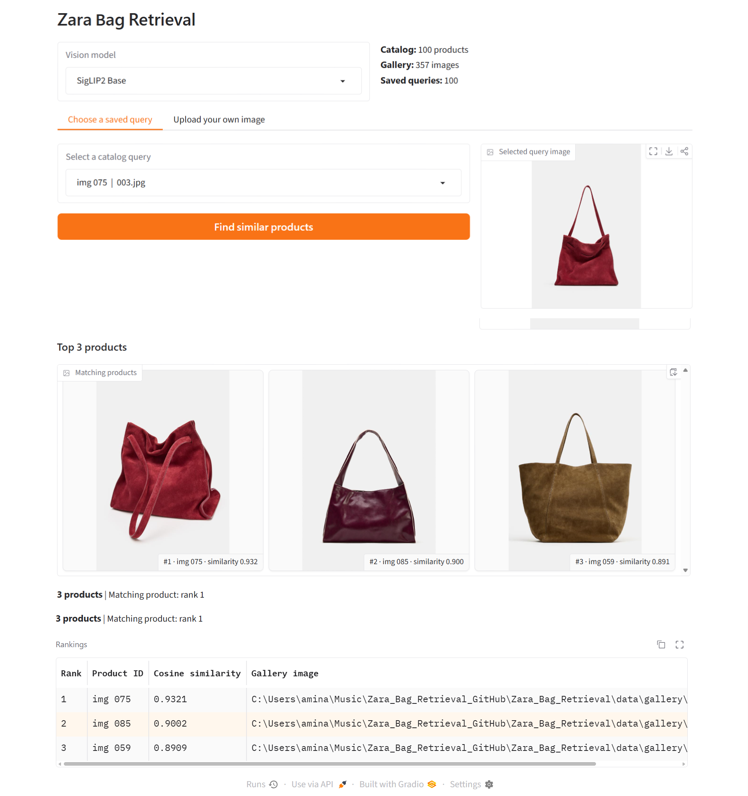

# Zara Bag Retrieval

**Image-to-image fashion product retrieval using DINOv2, DINOv3, and SigLIP2.**

A computer vision pipeline that represents handbag images as feature embeddings, searches a product gallery with **FAISS**, and returns the **top 3 most similar distinct products**. The pretrained vision models are used without task-specific fine-tuning.

## Demo



*Gradio demo: select a saved product image or upload a new photo, choose a vision model, and inspect ranked matches with cosine similarity scores. The example shows **100 products**, **357 gallery images**, and **100 saved queries**.*

## Vision Models

| Encoder | Visual representation |
| --- | --- |
| **DINOv2 Small** (`facebook/dinov2-small`) | Self-supervised ViT features extracted from the `[CLS]` token. |
| **DINOv3 Small** (`facebook/dinov3-vits16-pretrain-lvd1689m`) | More recent self-supervised ViT features, also using the `[CLS]` token. |
| **SigLIP2 Base** (`google/siglip2-base-patch16-224`) | Image embeddings from a vision-language pretrained image encoder. |

Each model has its **own embedding space and search index**, so the interface can compare their retrieval results.

## How It Works

1. **Build once:** `build_artifacts.py` encodes query and gallery images with each selected model, L2-normalizes the vectors, and saves embeddings plus a model-specific **FAISS `IndexFlatIP`** index.
2. **Provide a query:** In the Gradio UI, find a saved image by **product ID** (cached embedding), or **upload an image** (encoded on demand).
3. **Retrieve:** Search the selected model's gallery index. Because vectors are normalized, inner-product scores correspond to **cosine similarity**.
4. **Show results:** Rank matches, remove duplicate product IDs, and display the **top 3 different products** with thumbnails and similarity scores.

`Bag image → Vision encoder → Normalized embedding → FAISS similarity search → Top-3 products`

## Quick Start

**Python 3.10+**

```bash
python -m pip install -r requirements.txt
```

Place your images in matching product-ID folders under `data/query/` and `data/gallery/`, for example:

```text
data/
├── query/img 062/004.jpg
└── gallery/img 062/001.jpg
```

Then generate the model embeddings and launch the UI:

```bash
python build_artifacts.py --batch-size 2
python app.py
```

Open **http://127.0.0.1:7860**.

> **DINOv3 access:** Its Hugging Face checkpoint may require approval and `hf auth login`. To build the other two encoders only, use `python build_artifacts.py --models dinov2 siglip2`.

**Stack:** PyTorch · Hugging Face Transformers · DINOv2 · DINOv3 · SigLIP2 · FAISS · Gradio

*Dataset images and generated model artifacts are not included in the repository; the indexes are created locally during setup.*
