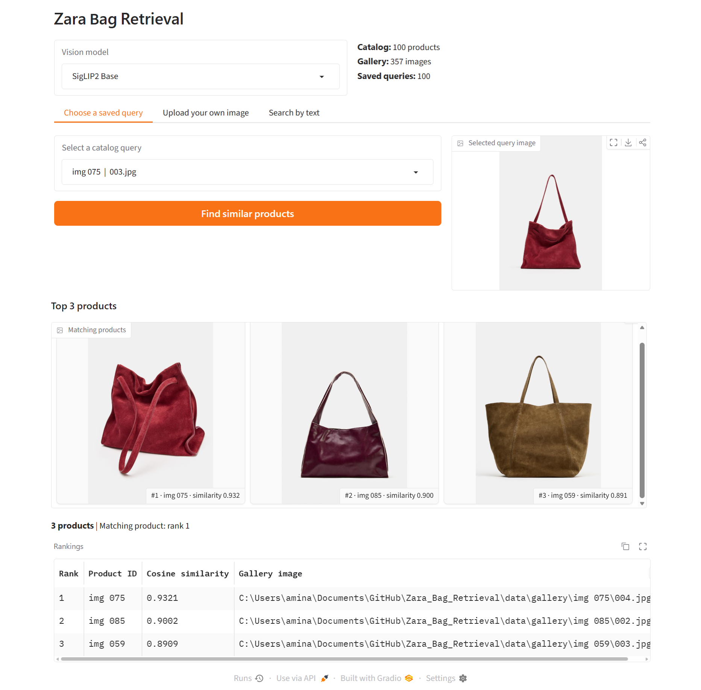
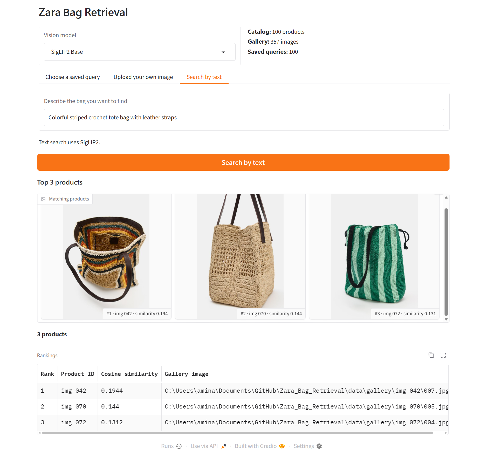

# Zara Bag Retrieval

**Image-to-image and text-to-image retrieval powered by DINOv2, DINOv3, and SigLIP2.**

A computer vision project for searching a fashion catalog of 100 bags and 357 gallery images. It uses pretrained vision and vision-language encoders to generate embeddings, FAISS for nearest-neighbor search, and a Gradio interface to display the top 3 most similar distinct products. No task-specific fine-tuning is required.

## Retrieval Demos

### 1. Image-to-Image Search



Choose a saved catalog image by product ID or **upload your own bag photo**. Select **DINOv2, DINOv3, or SigLIP2** to retrieve visually similar bags, ranked by cosine similarity. Saved queries use cached embeddings; uploaded images are encoded on demand.

### 2. Text-to-Image Search



Describe the bag in natural language, for example: **“Colorful striped crochet tote bag with leather straps.”** **SigLIP2** embeds the text and searches for the closest catalog images in its shared text-image embedding space. Text search uses SigLIP2 regardless of the vision model selected for image search.

## How It Works

1. **Offline indexing:** `build_artifacts.py` extracts gallery and saved-query embeddings for each model, L2-normalizes them, and builds a separate **FAISS `IndexFlatIP`** index for each encoder.
2. **Query encoding:** A saved image uses its precomputed embedding; an uploaded image uses the chosen vision encoder; a text prompt uses SigLIP2's text encoder.
3. **Similarity search:** FAISS ranks normalized embeddings by inner product (cosine similarity). Results are deduplicated by product ID.
4. **Results:** Gradio shows the top 3 distinct products, representative images, product IDs, and similarity scores.

> Similarity scores are retrieval scores, not classification probabilities; text and image query scores should not be interpreted as directly comparable confidence levels.

## Quick Start

**Requirements:** Python 3.10+ and the dataset arranged as `data/query/<product ID>/<image>.jpg` and `data/gallery/<product ID>/<image>.jpg`.

```bash
python -m pip install -r requirements.txt
python build_artifacts.py --batch-size 2
python app.py
```

Open **http://127.0.0.1:7860** and try a saved image, an upload, or a text description.
